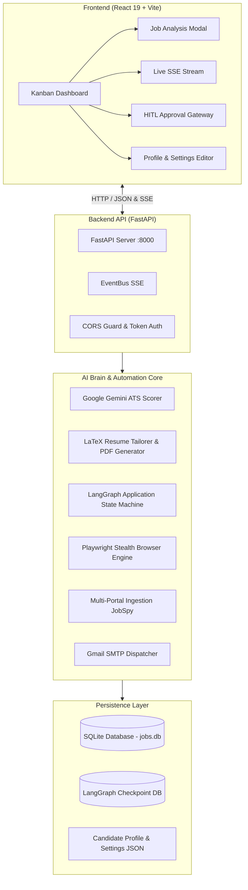

<div align="center">

# 🤖 Autonomous Job Automation Agent
### Next-Generation AI Career Command Center & Application Engine

[](https://www.python.org/)
[](https://fastapi.tiangolo.com/)
[](https://react.dev/)
[](https://vitejs.dev/)
[](https://langchain-ai.github.io/langgraph/)
[](https://playwright.dev/)
[](https://aistudio.google.com/)
[](LICENSE)

*An enterprise-grade, autonomous full-stack agent that crawls multi-portal job boards, semantically evaluates ATS fit with Google Gemini, generates job-tailored LaTeX/PDF resumes, stages form applications with Playwright stealth browser automation, and pauses at a Human-in-the-Loop (HITL) visual approval gateway before submission.*

</div>

---

## 🌟 Executive Overview

The **Autonomous Job Automation Agent** replaces fragmented job search workflows with an intelligent, end-to-end AI agent pipeline designed with production-grade engineering principles:

- **Intelligent Multi-Portal Crawling**: Concurrent discovery across LinkedIn, Indeed, Naukri, and Glassdoor with deduplication and rate-limiting.
- **ATS Semantic Match Scoring**: Powered by Google Gemini to analyze keywords, technical proficiencies, role requirements, and provide gap recommendations.
- **Dynamic LaTeX Resume Tailoring**: Compiles tailored ATS-compliant PDF resumes highlighting candidate strengths matched directly to the target job description.
- **LangGraph State Machine Orchestration**: Deterministic workflow execution with state checkpoints and human review interrupts.
- **Human-in-the-Loop (HITL) Gateway**: Visual review system with live Playwright browser snapshot capture before submitting any application.
- **Real-Time Event Streaming**: Sub-Phase Server-Sent Events (SSE) broadcasting live agent status, discovery logs, and progress indicators.
- **Recruiter Cold Email Outreach**: Automated personalized recruiter email generator with Gmail SMTP dispatch and PDF attachment support.
- **Modern Glassmorphic Dashboard**: High-performance React 19 Kanban board, analytics funnel, profile editor, and interactive application modals.

---

## 🏗️ System Architecture



---

## 📂 Project Directory Structure

```text
Job_Automation_Agent/
├── backend/
│   ├── app/
│   │   ├── agent/               # Autonomous agent modules
│   │   │   ├── applier.py       # Playwright browser automation & form filler
│   │   │   ├── discoverer.py    # Multi-portal job scraper via JobSpy
│   │   │   ├── mailer.py        # Gmail SMTP recruiter cold email dispatcher
│   │   │   ├── outreach.py      # AI cold email & LinkedIn note generator
│   │   │   ├── pdf_generator.py # Dynamic LaTeX & ReportLab PDF compiler
│   │   │   ├── qa_bank.py       # Screening questions and candidate memory bank
│   │   │   ├── resume_parser.py # AI resume extractor and parser
│   │   │   ├── scorer.py        # Gemini ATS evaluation and scoring
│   │   │   ├── tailorer.py      # LaTeX resume tailoring engine
│   │   │   └── workflow.py      # LangGraph state machine with HITL interrupt
│   │   ├── db/                  # SQLite models, sessions, and CRUD operations
│   │   │   ├── crud.py
│   │   │   ├── models.py
│   │   │   └── session.py
│   │   ├── schemas/             # Pydantic v2 data transfer schemas
│   │   │   ├── api.py
│   │   │   ├── match.py
│   │   │   ├── outreach.py
│   │   │   └── profile.py
│   │   ├── utils/               # Shared utilities & SSE EventBus
│   │   │   └── event_bus.py
│   │   └── config.py            # Environment validation & secrets configuration
│   ├── data/
│   │   ├── account_settings.example.json # Safe configuration template
│   │   └── mock_easy_apply.html          # Local test fixture for browser automation
│   ├── main.py                  # FastAPI server entry point & REST routes
│   ├── profile.json             # Master candidate profile and skills
│   ├── requirements.txt         # Pinned Python dependencies
│   └── .env.example             # Backend environment template
├── frontend/
│   ├── public/                  # Static assets and icons
│   ├── src/
│   │   ├── assets/              # Logos and graphics
│   │   ├── components/          # React 19 UI component library
│   │   │   ├── AccountsSettings.jsx # Portal credentials and SMTP configuration
│   │   │   ├── ApplicationModal.jsx # HITL interactive application review
│   │   │   ├── DiscoveryModal.jsx   # Multi-portal autonomous discovery dialog
│   │   │   ├── JobModal.jsx         # Detailed job evaluation and ATS scorecard
│   │   │   ├── KanbanBoard.jsx      # Interactive status board with drag & drop
│   │   │   ├── Navbar.jsx           # Top navigation and health indicators
│   │   │   ├── ProfileEditor.jsx    # Candidate profile editor & resume uploader
│   │   │   ├── StatsBar.jsx         # Live analytics and KPI counters
│   │   │   ├── TableView.jsx        # Data grid alternative view
│   │   │   └── Toast.jsx            # Notification system
│   │   ├── api.js               # Central API client and SSE listener
│   │   ├── App.jsx              # Application shell and tab routing
│   │   ├── App.css              # Custom layout stylings
│   │   ├── index.css            # Design tokens, themes, and glassmorphic utilities
│   │   └── main.jsx             # React DOM entry point
│   ├── package.json             # Frontend dependencies
│   └── vite.config.js           # Vite dev server with backend proxy
├── docs/                        # Engineering blueprints and architectural guides
│   ├── Feature_Buildings_things.md
│   ├── Fullstack_Architecture_Standards.md
│   ├── Job_Automation_Agent_Plan.md
│   ├── LangGraph_Workflow_Guide.md
│   ├── Preferences.md
│   ├── Prerequisites.md
│   ├── Project_Master_Guide.md
│   └── Step_By_Step_Implementation_Roadmap.md
├── .env.example                 # Root environment template
├── .gitignore                   # Enterprise gitignore preventing secret leakage
└── README.md                    # System documentation
```

---

## ⚡ Quick Start & Installation

### Prerequisites

- **Python**: 3.12+ (64-bit)
- **Node.js**: v18+ or v20+
- **Google Gemini API Key**: Free tier available from [Google AI Studio](https://aistudio.google.com/)

---

### 1. Clone the Repository

```bash
git clone https://github.com/Jayasurya227/Job_Automation_Agent.git
cd Job_Automation_Agent
```

---

### 2. Backend Setup

```bash
cd backend

# Create and activate Python virtual environment
python -m venv venv

# On Windows:
.\venv\Scripts\activate
# On Linux/macOS:
# source venv/bin/activate

# Install dependencies
pip install -r requirements.txt

# Install Playwright browser engines
playwright install chromium

# Configure environment variables
cp .env.example .env
```

Open `backend/.env` and insert your Gemini API key:
```ini
GEMINI_API_KEY="your_actual_gemini_api_key_here"
```

Start the FastAPI backend server:
```bash
python -m uvicorn main:app --host 127.0.0.1 --port 8000 --reload
```
*Backend runs on `http://127.0.0.1:8000` (Interactive API docs at `http://127.0.0.1:8000/docs`).*

---

### 3. Frontend Setup

Open a new terminal window:

```bash
cd frontend

# Install npm packages
npm install

# Start Vite dev server
npm run dev
```
*Frontend runs on `http://localhost:5173` with automatic proxying to `:8000`.*

---

## 🔒 Security & Architectural Guardrails

| Principle | Implementation |
| :--- | :--- |
| **Zero Blind Trust** | All inputs (jobs, search queries, profiles) validated with strict Pydantic v2 models. |
| **Zero Secret Leakage** | `.env`, credentials, local SQLite databases, session cookies, and output PDFs strictly git-ignored. |
| **Strict Network Isolation** | FastAPI configured with explicit CORS origin constraints (`localhost:5173`, `127.0.0.1:5173`). |
| **Human-in-the-Loop Gateway** | LangGraph pauses before final application submission, requiring explicit candidate visual approval. |
| **Rate-Limited Cold Outreach** | Gmail SMTP limits enforced in code to protect sender reputation and prevent spam triggers. |

---

## 🧪 Testing & Validation

The codebase includes an extensive suite of integration and unit tests covering all phases:

```bash
cd backend
.\venv\Scripts\activate

# Run full test suite
pytest -v

# Run specific integration tests
pytest test_api.py -v
pytest test_workflow.py -v
pytest test_hitl_gateway.py -v
```

---

## 📚 Technical Documentation

Comprehensive architectural design records and guides are located in the [`docs/`](docs/) directory:

- 📐 [Full-Stack Architecture Standards](docs/Fullstack_Architecture_Standards.md)
- 🧠 [LangGraph Workflow State Machine Guide](docs/LangGraph_Workflow_Guide.md)
- 🗺️ [Step-by-Step Implementation Roadmap](docs/Step_By_Step_Implementation_Roadmap.md)
- 📖 [Project Master Guide](docs/Project_Master_Guide.md)
- 📋 [Prerequisites & System Requirements](docs/Prerequisites.md)
- 🎯 [Feature Specifications](docs/Feature_Buildings_things.md)

---

## 📄 License

This project is licensed under the [MIT License](LICENSE).
