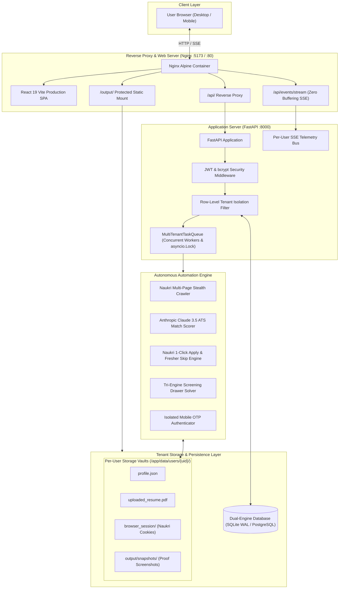

[](https://hub.xerj.org/contributors/Jayasurya227)

<div align="center">

# 🤖 Autonomous Job Automation Agent
### Enterprise Multi-User AI Job Application SaaS Platform (Dockerized)

[](https://www.python.org/)
[](https://fastapi.tiangolo.com/)
[](https://react.dev/)
[](https://vitejs.dev/)
[](https://www.docker.com/)
[](https://nginx.org/)
[](https://playwright.dev/)
[](https://www.anthropic.com/)
[_|_PostgreSQL-003B57.svg?logo=sqlite&logoColor=white)](https://sqlite.org/)
[](LICENSE)

*An enterprise-grade, multi-tenant autonomous AI career command center and application platform. Engineered with Playwright stealth browser automation for Naukri.com, cryptographic JWT authentication, per-user isolated storage vaults, concurrent task queuing, real-time SSE telemetry, and full Docker containerization.*

</div>

---

## 🌟 Executive Overview

The **Autonomous Job Automation Agent** has evolved from an individual developer script into a production-grade, containerized **Multi-Tenant SaaS Platform**. The platform enables multiple concurrent candidates to register, securely upload personalized resumes, configure custom ATS thresholds, connect their dedicated **Naukri.com** accounts via Mobile OTP, and execute autonomous job application pipelines simultaneously with zero cross-tenant data leakage.

### Key Architectural Pillars:
- **Enterprise Multi-Tenancy & Cryptographic Security**: Secure registration and login powered by bcrypt password hashing and Bearer JWT access tokens. Every database query, job record, application event, and file transaction is strictly scoped to the authenticated `user_id`.
- **Per-User Isolated Storage Vaults (`data/users/{user_id}/`)**: Each candidate receives an independent physical storage vault containing their custom profile, master PDF resume, stealth browser cookies (`browser_session/`), and visual proof snapshots.
- **Zero-Theft Resume Guard & Anti-Hijacking OTP Guard**: Resumes, profiles, and live browser sessions are cryptographically isolated. Disconnecting or authenticating a Naukri portal session for one candidate never affects another candidate.
- **Concurrent Multi-Tenant Task Queue**: Built-in asynchronous queue (`MultiTenantTaskQueue`) featuring per-user execution locks (`asyncio.Lock()`) and dedicated worker routines, allowing User A to run deep discovery while User B submits applications simultaneously without server blocking.
- **Naukri.com Stealth Browser Automation**: Playwright-driven crawling with dynamic semantic query expansion, anti-detection flags (`--disable-blink-features=AutomationControlled`), humanized typing jitter (15ms–45ms), randomized pause intervals, and persistent session reuse.
- **Tri-Engine Screening Chatbot Solver**: Autonomous 1-Click apply engine handling complex Naukri screening chatbot drawers:
  - *Layer 1 (Candidate Facts):* Instant recall of notice period, current location, and verified experience from candidate memory.
  - *Layer 2 (Adaptive Fresher Salary Skip):* Detects fresher status (<1 year exp) and intelligently clicks "Skip", selects "Not Disclosed / Negotiable", or injects safe numeric fallbacks (`0`) to prevent submission stalls.
  - *Layer 3 (Fast LLM Bridge):* Connected to **Claude 3.5 Haiku** (`claude-haiku-5-5`) for dynamic technical MCQs and custom recruiter screening questions.
- **Anti-Eavesdropping SSE EventBus**: Real-time Server-Sent Events stream live job application progress, logs, and metrics exclusively to the authenticated user's active session.
- **Master User Deletion Shield**: Comprehensive administrative cleanup utility with safeguards preventing accidental deletion of the primary platform administrator (`Rayavaram Jayasurya`) while allowing surgical tenant cleanup.
- **Dual-Engine Database Support**: SQLAlchemy 2.0 ORM designed dialect-agnostic. Operates out-of-the-box on embedded multi-tenant SQLite with WAL mode and foreign key enforcement, or seamlessly connects to Cloud PostgreSQL (`DATABASE_URL=postgresql://...`) with 0 code changes.
- **Production Docker & Nginx Orchestration**: Complete microservices packaging with non-root security (`appuser:1001`), shared memory allocation (`shm_size: 2gb`) for Playwright Chromium, Nginx reverse proxy with zero-buffering for SSE, and single-command startup.

---

## 🏗️ System Architecture



---

## 📂 Project Directory Structure

```text
Job_Automation_Agent/
├── docker-compose.yml           # Unified multi-container microservices orchestration
├── Dockerfile.backend           # Backend container (Python 3.12, Playwright, Chromium, non-root)
├── Dockerfile.frontend          # Frontend container (Node 20 Vite build + Nginx Alpine)
├── start.sh                     # Production 1-command startup script (Linux / macOS / Cloud VM)
├── start.bat                    # Production 1-command startup script (Windows)
├── .env.docker.example          # Environment variables template for Docker deployment
├── MULTI_USER_DOCKER_ROADMAP.md # Detailed 5-phase SaaS transition & verification ledger
├── backend/
│   ├── app/
│   │   ├── agent/               # Autonomous agent & task scheduling modules
│   │   │   ├── applier.py       # Playwright 1-Click apply, chatbot drawer & fresher skip
│   │   │   ├── booster.py       # Recruiter profile booster & activity simulator
│   │   │   ├── browser.py       # Per-user persistent Chromium browser context launcher
│   │   │   ├── headless_auth.py # Per-user headless mobile OTP authenticator for Naukri
│   │   │   ├── ingestion.py     # Deduplication, classification, and triage pipeline
│   │   │   ├── llm.py           # Anthropic Claude client wrapper & JSON parser
│   │   │   ├── qa_bank.py       # Screening questionnaire solver & candidate fact memory
│   │   │   ├── query_expander.py# Semantic search term generator
│   │   │   ├── resume_parser.py # AI resume extractor and parser
│   │   │   ├── scheduler.py     # Autonomous auto-pilot timetable scheduler
│   │   │   ├── scorer.py        # Claude ATS evaluation and weighted scoring
│   │   │   ├── scraper.py       # Stealth Naukri crawler with multi-page pagination
│   │   │   ├── stealth.py       # Anti-detection flags & human mouse/typing simulation
│   │   │   ├── task_queue.py    # MultiTenantTaskQueue with per-user locks & concurrency
│   │   │   └── workflow.py      # Application state machine and review gates
│   │   ├── core/                # Core infrastructure, security & storage utilities
│   │   │   ├── security.py      # JWT token generation, verification & bcrypt hashing
│   │   │   ├── user_cleanup.py  # Surgical tenant purge with Master User Deletion Shield
│   │   │   └── user_storage.py  # Per-user vault path resolver & zero-theft isolation
│   │   ├── db/                  # Multi-tenant models, session & CRUD operations
│   │   │   ├── crud.py          # Tenant-scoped job records, daily quotas & transactions
│   │   │   ├── models.py        # Declarative SQLAlchemy models with user_id foreign keys
│   │   │   └── session.py       # Thread-safe dual-engine session maker (SQLite WAL / Postgres)
│   │   ├── routers/             # API routing controllers
│   │   │   └── auth.py          # /api/auth/register, /api/auth/login, /api/auth/me
│   │   ├── schemas/             # Pydantic v2 data validation schemas
│   │   │   ├── api.py           # API payload schemas
│   │   │   ├── match.py         # Match evaluation schemas
│   │   │   ├── outreach.py      # Outreach schemas
│   │   │   └── profile.py       # Profile schemas
│   │   ├── utils/               # Shared utilities & SSE EventBus
│   │   │   ├── event_bus.py     # Multi-tenant real-time event streaming bus
│   │   │   └── rate_limiter.py  # API rate-limiting utilities
│   │   └── config.py            # Environment configurations, quotas & JWT settings
│   ├── data/
│   │   ├── jobs.db              # Multi-tenant SQLite database (WAL mode, foreign keys)
│   │   └── users/               # Per-user isolated storage vaults
│   │       └── {user_id}/       # Specific tenant vault (profile, resume, session, snapshots)
│   ├── main.py                  # FastAPI server entry point, routers & REST endpoints
│   ├── requirements.txt         # Pinned Python production dependencies (FastAPI, Playwright, etc.)
│   ├── test_phase1.py           # Verification suite: Multi-Tenant Schema & JWT Authentication
│   ├── test_phase2_step1-4.py   # Verification suite: Storage Vaults & Session Isolation
│   ├── test_phase3_step1-3.py   # Verification suite: Concurrent Task Queue & SSE Guard
│   ├── test_phase4_step1-3.py   # Verification suite: Docker & Nginx Packaging
│   ├── test_phase5_step1.py     # Verification suite: 2-User Provisioning & Data Isolation
│   ├── test_phase5_step2.py     # Verification suite: Dual Naukri Session & Anti-Hijack Guard
│   └── test_phase5_step3.py     # Verification suite: Concurrent Execution & Tenant Purge
├── frontend/
│   ├── nginx.conf               # Production Nginx reverse proxy, static cache & SSE config
│   ├── src/
│   │   ├── components/          # React 19 UI component library
│   │   │   ├── AccountsSettings.jsx   # Portal credentials and daily quota controls
│   │   │   ├── ApplicationHistory.jsx # Application archive & telemetry history
│   │   │   ├── ApplicationModal.jsx   # Interactive application review modal
│   │   │   ├── AuthModal.jsx          # Multi-user Sign Up / Sign In dialog
│   │   │   ├── AuthPage.jsx           # Portal login and OTP verification screen
│   │   │   ├── DiscoveryModal.jsx     # Multi-page manual discovery trigger dialog
│   │   │   ├── JobModal.jsx           # Detailed job inspection & ATS scorecard
│   │   │   ├── KanbanBoard.jsx        # Interactive status board with responsive cards
│   │   │   ├── Navbar.jsx             # Tenant avatar, health indicators and controls
│   │   │   ├── ProfileEditor.jsx      # Per-user profile editor & master resume manager
│   │   │   ├── QuotaModal.jsx         # Daily quota warning & custom limit editor
│   │   │   ├── StatsBar.jsx           # Live analytics and KPI performance counters
│   │   │   ├── TableView.jsx          # Data grid alternative view
│   │   │   └── Toast.jsx              # Notification toast alerts
│   │   ├── context/
│   │   │   └── AuthContext.jsx        # React Auth provider managing JWT tokens & tenant state
│   │   ├── utils/
│   │   │   └── jobClassification.js   # 1-Click vs External Company link classification
│   │   ├── api.js               # Central API client with Bearer auth & SSE telemetry
│   │   ├── App.jsx              # Application shell and tab routing
│   │   ├── App.css              # Layout stylings
│   │   ├── index.css            # Glassmorphic tokens, themes, and mobile media queries
│   │   └── main.jsx             # React DOM entry point
│   ├── package.json             # Frontend dependencies
│   └── vite.config.js           # Vite dev server configuration
├── docs/                        # Complete architecture blueprints, standards & roadmaps
├── .gitignore                   # Enterprise gitignore preventing secret/cookie leakage
├── LICENSE                      # MIT License
└── README.md                    # System documentation
```

---

## ⚡ Quick Start & Deployment

### Method 1: One-Command Production Docker Launch (Recommended)

Ensure [Docker](https://www.docker.com/) and [Docker Compose](https://docs.docker.com/compose/) are installed.

1. **Clone the Repository**:
   ```bash
   git clone https://github.com/Jayasurya227/Job_Automation_Agent.git
   cd Job_Automation_Agent
   ```

2. **Configure Environment Variables**:
   ```bash
   cp .env.docker.example .env
   ```
   Open `.env` and add your Anthropic Claude API key:
   ```ini
   ANTHROPIC_API_KEY="your_actual_anthropic_api_key_here"
   JWT_SECRET="your_secure_random_secret_key"
   ```

3. **Start the Platform**:
   - **On Linux / macOS / Cloud VM**:
     ```bash
     chmod +x start.sh
     ./start.sh
     ```
   - **On Windows**:
     ```cmd
     start.bat
     ```
   - **Or directly with Docker Compose**:
     ```bash
     docker compose up -d --build
     ```

4. **Access the Application**:
   - Open your browser at **`http://localhost:5173`**
   - Register a new account (or sign in with your credentials).
   - Your isolated tenant vault is automatically initialized at `data/users/{your_user_id}/`.

---

### Method 2: Local Developer Setup (Bare Metal)

#### Backend Setup:
```bash
cd backend

# Create and activate Python virtual environment
python -m venv venv

# On Windows:
.\venv\Scripts\activate
# On Linux/macOS:
source venv/bin/activate

# Install dependencies
pip install -r requirements.txt

# Install Playwright browser engine
playwright install chromium

# Configure environment variables
cp .env.example .env
```
Add your `ANTHROPIC_API_KEY` to `backend/.env`, then run:
```bash
python -m uvicorn main:app --host 127.0.0.1 --port 8000 --reload
```
*Backend runs on `http://127.0.0.1:8000` (API docs at `http://127.0.0.1:8000/docs`).*

#### Frontend Setup:
Open a new terminal window:
```bash
cd frontend
npm install
npm run dev
```
*Frontend runs on `http://localhost:5173` with proxying to `:8000`.*

---

## 🔒 Security, Tenant Privacy & Anti-Detection Matrix

| Security / Anti-Detection Layer | Implementation Details |
| :--- | :--- |
| **Row-Level Tenant Security** | Every database query enforces `WHERE user_id = current_user.id`. Cross-user data leakage is physically impossible. |
| **Zero-Theft Storage Vaults** | Resumes, tailored PDFs, and settings are stored strictly in `data/users/{uid}/`. Static mounts validate user authorization. |
| **Anti-Hijacking OTP Guard** | Naukri mobile OTP and Playwright browser cookies are partitioned in `data/users/{uid}/browser_session/`. Disconnecting User B never affects User A. |
| **Anti-Eavesdropping SSE Guard** | Real-time event streams (`/api/events/stream`) require valid JWT authentication and filter events strictly to the recipient's `user_id`. |
| **Master User Deletion Shield** | Tenant cleanup functions in `user_cleanup.py` refuse deletion of Master User ID: 1 (`Rayavaram Jayasurya`) to protect system integrity. |
| **Non-Root Docker Execution** | Backend container runs under isolated system user `appuser:1001`, blocking container breakouts. |
| **Dual-Engine DB Support** | Operates on embedded multi-tenant SQLite with WAL mode, or connects to Cloud PostgreSQL via `DATABASE_URL` with zero code rewrites. |
| **Stealth Crawler Flags** | Playwright launches Chromium with `--disable-blink-features=AutomationControlled`, randomized viewports, and custom navigator properties. |
| **Humanized Timing & Jitter** | Injects 15ms–45ms typing jitter between keystrokes and 1.5s–3.5s organic delays between page actions to avoid bot flags. |
| **Strict Anti-Ban Quotas** | Daily application rate limiters (default 25/day, customizable per candidate) pause the auto-pilot when reaching safety ceilings. |

---

## 🧪 Comprehensive Verification Test Suites

Every architectural layer is backed by dedicated, automated test suites located in `backend/`:

| Test Suite | Scope & Verification Coverage | Status |
| :--- | :--- | :--- |
| **`test_phase1.py`** | Users DB schema, password hashing, JWT creation & validation, tenant-scoped queries | ✅ Passed |
| **`test_phase2_step1-4.py`** | Per-user storage vaults, zero-theft resume checks, headless OTP flow, tenant portal logout | ✅ Passed |
| **`test_phase3_step1-3.py`** | MultiTenantTaskQueue concurrency, per-user lock isolation, SSE anti-eavesdropping guard | ✅ Passed |
| **`test_phase4_step1-3.py`** | Dockerfile configurations, Nginx reverse proxy syntax, Docker Compose service validation | ✅ Passed |
| **`test_phase5_step1.py`** | Dual-user provisioning, cryptographic JWT independence, master deletion shield | ✅ Passed |
| **`test_phase5_step2.py`** | Dual Naukri browser session isolation, OTP anti-hijacking, portal disconnect independence | ✅ Passed |
| **`test_phase5_step3.py`** | Concurrent multi-tenant task execution, discrete skill profiles, snapshot isolation & tenant purge | ✅ Passed |

Run any test suite using:
```bash
cd backend
python test_phase1.py
python test_phase5_step3.py
```

---

## 🌍 Open-Source Indexing & Benchmark Reference

This project's reference architecture has been reviewed, selected, and indexed into the **[XERJ Corpus Hub](https://hub.xerj.org/contributors/Jayasurya227)** (founded by Ivan Novikov, Y Combinator alumnus & Wallarm CEO) as a verified worked example for AI coding agents retrieving battle-tested automation architectures.

- **Verified Contributor Profile:** [https://hub.xerj.org/contributors/Jayasurya227](https://hub.xerj.org/contributors/Jayasurya227)
- **Official Engine Repository:** [https://github.com/xerj-org/xerj](https://github.com/xerj-org/xerj)

---

## 📄 License

This project is licensed under the [MIT License](LICENSE).
