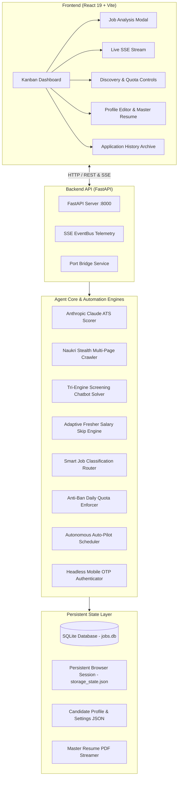

[](https://hub.xerj.org/contributors/Jayasurya227)

<div align="center">

# 🤖 Autonomous Job Automation Agent
### Next-Generation AI Career Command Center & Application Engine

[](https://www.python.org/)
[](https://fastapi.tiangolo.com/)
[](https://react.dev/)
[](https://vitejs.dev/)
[](https://playwright.dev/)
[](https://www.anthropic.com/)
[](https://sqlite.org/)
[](LICENSE)

*An enterprise-grade, autonomous full-stack agent designed for continuous, hands-free job discovery and application on Naukri. Engineered with Playwright stealth browser automation, persistent session reuse, Anthropic Claude AI brain for zero-hallucination ATS match scoring, adaptive fresher screening questionnaires, and anti-ban safety rate limiters.*

</div>

---

## 🌟 Executive Overview

The **Autonomous Job Automation Agent** transforms manual job hunting into an autonomous, resilient AI cockpit. Initially indexed by the **XERJ Corpus Hub at 27 files and 2,807 lines of code**, the architecture has since evolved into a production-grade enterprise system spanning **80+ source modules and ~24,500+ lines of full-stack code** across Python (FastAPI) and JavaScript (React). The agent operates as a personalized career command center built on strict engineering principles:

- **Stealth Multi-Page Crawling**: Deep live portal pagination on Naukri with dynamic semantic query expansion (`query_expander.py`), anti-detection flags (`--disable-blink-features=AutomationControlled`), and persistent Chrome session reuse (`storage_state.json`) bypassing repeated logins.
- **Zero-Hallucination ATS Scorer**: Real-time semantic matching powered by **Anthropic Claude (Claude 3.5 Haiku / Sonnet)**. Accurately evaluates candidate strengths against target JDs, computes weighted fit percentages, and provides actionable skill gap recommendations.
- **Tri-Engine Screening Chatbot Solver**: Autonomous 1-Click apply engine handling complex Naukri screening chatbot drawers:
  - *Layer 1 (Candidate Facts):* Instant recall of notice period, current location, and experience from `qa_bank.py`.
  - *Layer 2 (Adaptive Fresher Salary Skip):* Detects fresher status (<1 year exp) and intelligently targets "Skip" buttons/links, MCQ "Not Disclosed / Negotiable", or a safe numeric fallback (`0`) to prevent submission stalls.
  - *Layer 3 (Fast LLM Bridge):* Connected to **Claude 3.5 Haiku** (`claude-haiku-5-5`) for dynamic technical MCQs and custom recruiter screening questions.
- **Smart Job Classification Engine**: Deterministic classification separating Direct 1-Click Apply jobs from Company Portal external links (`jobClassification.js`). Seamlessly opens external job links directly in new tabs without triggering false warnings or broken auto-apply loops.
- **Anti-Ban Safety Guardrails & Quotas**: Built-in daily application rate limiters (configurable, default 25/day), humanized typing jitter (15ms–45ms delays), randomized action pauses (1.5s–3.5s), and strict execution quotas to protect candidate accounts from portal flags.
- **Autonomous Auto-Pilot Cadence**: Hands-free background timetable (e.g. 9:00 AM – 9:00 PM) cycling through scheduled discovery, evaluation, and application stages without human intervention.
- **Streamlined Master Resume Pipeline**: Zero-latency direct streaming of candidate master PDF resumes directly into portal upload containers, eliminating brittle LaTeX compilation overhead.
- **Glassmorphic Command Center**: Modern React 19 + Tailwind Kanban board (Discovered, Filtered, Ready, Applied, Rejected) with live Server-Sent Events (SSE) telemetry, job inspection modals, quota management dialogs, and mobile-responsive layout.

---

## 🏗️ System Architecture



---

## 📂 Project Directory Structure

```text
Job_Automation_Agent/
├── backend/
│   ├── app/
│   │   ├── agent/               # Autonomous agent modules
│   │   │   ├── applier.py       # Playwright 1-Click apply, chatbot drawer & fresher skip
│   │   │   ├── booster.py       # Recruiter profile booster & activity simulator
│   │   │   ├── browser.py       # Persistent Chromium browser context launcher
│   │   │   ├── headless_auth.py # Headless mobile OTP authenticator for Naukri
│   │   │   ├── ingestion.py     # Deduplication, classification, and triage pipeline
│   │   │   ├── llm.py           # Anthropic Claude client wrapper & JSON parser
│   │   │   ├── qa_bank.py       # Screening questionnaire solver & candidate fact memory
│   │   │   ├── query_expander.py# Semantic search term generator
│   │   │   ├── resume_parser.py # AI resume extractor and parser
│   │   │   ├── scheduler.py     # Autonomous auto-pilot timetable scheduler
│   │   │   ├── scorer.py        # Claude ATS evaluation and weighted scoring
│   │   │   ├── scraper.py       # Stealth Naukri crawler with multi-page pagination
│   │   │   ├── stealth.py       # Anti-detection flags & human mouse/typing simulation
│   │   │   └── workflow.py      # Application state machine and review gates
│   │   ├── db/                  # SQLite models, sessions, and CRUD operations
│   │   │   ├── crud.py          # Daily quota checks, job records, and state transitions
│   │   │   ├── models.py        # Declarative SQLAlchemy models
│   │   │   └── session.py       # Thread-safe database engine & session maker
│   │   ├── schemas/             # Pydantic v2 data validation schemas
│   │   │   ├── api.py
│   │   │   ├── match.py
│   │   │   ├── outreach.py
│   │   │   └── profile.py
│   │   ├── utils/               # Shared utilities & SSE EventBus
│   │   │   ├── event_bus.py     # Real-time event streaming bus
│   │   │   └── rate_limiter.py  # API rate-limiting utilities
│   │   └── config.py            # Claude API client, quotas, thresholds, and secrets
│   ├── data/
│   │   ├── jobs.db              # SQLite persistence database
│   │   └── storage_state.json   # Persistent Chrome cookies & Naukri authentication
│   ├── main.py                  # FastAPI server entry point & REST endpoints
│   ├── port_bridge.py           # Multi-device mobile testing proxy bridge
│   ├── profile.json             # Master candidate profile and skills
│   └── requirements.txt         # Pinned Python production dependencies
├── frontend/
│   ├── src/
│   │   ├── components/          # React 19 UI component library
│   │   │   ├── AccountsSettings.jsx   # Portal credentials and daily quota controls
│   │   │   ├── ApplicationHistory.jsx # 7-day application archive & telemetry history
│   │   │   ├── ApplicationModal.jsx   # Interactive application review modal
│   │   │   ├── AuthPage.jsx           # Portal login and OTP verification screen
│   │   │   ├── DiscoveryModal.jsx     # Multi-page manual discovery trigger dialog
│   │   │   ├── JobModal.jsx           # Detailed job inspection & ATS scorecard
│   │   │   ├── KanbanBoard.jsx        # Interactive status board with responsive cards
│   │   │   ├── Navbar.jsx             # Health indicators and status controls
│   │   │   ├── ProfileEditor.jsx      # Candidate profile editor & resume manager
│   │   │   ├── QuotaModal.jsx         # Daily quota warning & custom limit editor
│   │   │   ├── StatsBar.jsx           # Live analytics and KPI performance counters
│   │   │   ├── TableView.jsx          # Data grid alternative view
│   │   │   └── Toast.jsx              # Notification toast alerts
│   │   ├── utils/
│   │   │   └── jobClassification.js   # 1-Click vs External Company link classification
│   │   ├── api.js               # Central API client and SSE telemetry listener
│   │   ├── App.jsx              # Application shell and tab routing
│   │   ├── App.css              # Layout stylings
│   │   ├── index.css            # Glassmorphic tokens, themes, and mobile media queries
│   │   └── main.jsx             # React DOM entry point
│   ├── package.json             # Frontend dependencies
│   └── vite.config.js           # Vite dev server configuration
├── .gitignore                   # Enterprise gitignore preventing secret/cookie leakage
├── LICENSE                      # MIT License
└── README.md                    # System documentation
```

---

## ⚡ Quick Start & Installation

### Prerequisites

- **Python**: 3.12+ (64-bit)
- **Node.js**: v18+ or v20+
- **Anthropic Claude API Key**: Available from [Anthropic Console](https://console.anthropic.com/)

---

### 1. Clone the Repository

```bash
git clone https://github.com/Jayasurya227/Job_Automation_Agent.git
cd Job_Automation_Agent
```

---

### 2. Backend Setup

```bash
cd backend

# Create and activate Python virtual environment
python -m venv venv

# On Windows:
.\venv\Scripts\activate
# On Linux/macOS:
# source venv/bin/activate

# Install dependencies
pip install -r requirements.txt

# Install Playwright browser engine
playwright install chromium

# Configure environment variables
cp .env.example .env
```

Open `backend/.env` and insert your Anthropic Claude API key:
```ini
ANTHROPIC_API_KEY="your_actual_anthropic_api_key_here"
CLAUDE_MODEL="claude-haiku-5-5"
```

Start the FastAPI backend server:
```bash
python -m uvicorn main:app --host 127.0.0.1 --port 8000 --reload
```
*Backend runs on `http://127.0.0.1:8000` (Interactive API docs at `http://127.0.0.1:8000/docs`).*

---

### 3. Frontend Setup

Open a new terminal window:

```bash
cd frontend

# Install npm packages
npm install

# Start Vite dev server
npm run dev
```
*Frontend runs on `http://localhost:5173` with automatic proxying to `:8000`.*

---

## 🔒 Security & Anti-Detection Guardrails

| Guardrail Principle | Implementation Details |
| :--- | :--- |
| **Strict Secret Boundary** | `ANTHROPIC_API_KEY` is loaded securely via `backend/app/config.py`. Server refuses startup if key is missing. Passwords are never stored in plaintext. |
| **Persistent Session Isolation** | Browser session state (`storage_state.json`) is stored locally and git-ignored. Prevents repeated OTP requests and IP flags. |
| **Strict Anti-Ban Quotas** | Daily application count is strictly enforced in SQLite (`MAX_APPLIES_PER_DAY = 25`). Applications automatically halt when quota is reached. |
| **Humanized Interaction Timing** | Keystrokes are injected with 15ms–45ms randomized jitter; action transitions include 1.5s–3.5s natural human delays. |
| **Stealth Crawler Flags** | Playwright launches Chromium with `--disable-blink-features=AutomationControlled` to prevent portal bot-detection triggers. |
| **Strict Match Thresholds** | Jobs must meet `READY_MATCH_THRESHOLD = 70` to reach Ready state; `AUTO_APPLY_MATCH_THRESHOLD = 75` is required for autonomous 1-click apply. |
| **Zero Secret Leakage** | `.env`, credentials, local SQLite databases, session cookies, and temporary traces are strictly git-ignored. |

---

## 🌍 Open-Source Indexing & Benchmark Reference

This project's reference architecture has been reviewed, selected, and indexed into the **[XERJ Corpus Hub](https://hub.xerj.org/contributors/Jayasurya227)** (founded by Ivan Novikov, Y Combinator alumnus & Wallarm CEO) as a verified worked example for AI coding agents retrieving battle-tested automation architectures.

- **Verified Contributor Profile:** [https://hub.xerj.org/contributors/Jayasurya227](https://hub.xerj.org/contributors/Jayasurya227)
- **Official Engine Repository:** [https://github.com/xerj-org/xerj](https://github.com/xerj-org/xerj)

---

## 📄 License

This project is licensed under the [MIT License](LICENSE).
