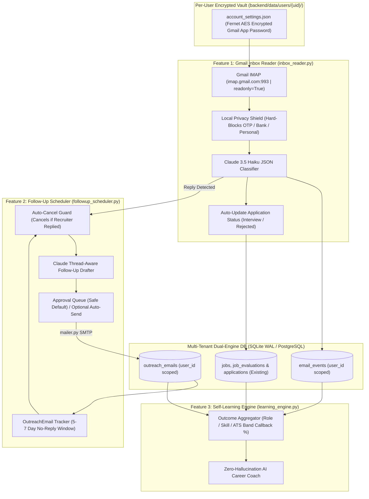

# 🧠 v3.0 Roadmap: Closed-Loop Agentic Career Intelligence
**Project:** Autonomous AI Job Application Agent (Enterprise Multi-User SaaS)  
**Author:** Rayavaram Jayasurya & Antigravity AI  
**Created:** 2026-11-18  
**Status:** Saved & Approved Architecture Blueprint (Ready for Phase-by-Phase Execution)  

---

## 📌 1. Problem Statement: "The Blind Automation Problem"

In **v2.0**, the platform excels at **Outbound Execution**: stealth multi-page Naukri crawling, zero-hallucination Anthropic Claude ATS scoring, tri-engine chatbot solving (with Adaptive Fresher Salary Skip), multi-tenant JWT isolation, concurrent task queuing, and Docker containerization.

However, once an application or recruiter cold email is dispatched, the agent goes **blind ("Fire & Forget")**:
1. **Buried Interviews & Stale Kanban Boards:** After applying to 300–500 jobs/month, real recruiter interview invitations and 24-hour coding assessments get buried under bank alerts, OTPs, newsletters, and automated "Thank you for applying" receipts. Meanwhile, all cards remain stuck in the `Applied` column unless manually updated.
2. **Lost Conversions from Missing Follow-Ups:** Over 60% of recruiter replies come from a polite follow-up sent 5–7 days after the initial outreach. Candidates forget who they emailed and when, losing high-probability interview callbacks.
3. **Zero Feedback Learning:** Without correlating real interview/rejection outcomes against job titles, skills, ATS score bands, and outreach subject lines, candidates keep spending daily quotas on low-callback roles instead of doubling down on what actually converts.

---

## 🔗 2. High-Level Closed-Loop Architecture

---

## 🛠️ 3. Tech Stack & Zero-Bloat Security Upgrades

| Component | Selected Technology | Architectural Rationale |
| :--- | :--- | :--- |
| **Gmail Inbox Access** | Python Standard Library `imaplib` + `email` | Zero extra dependencies, TLS on `imap.gmail.com:993`, strictly `readonly=True` (0% portal ban risk). |
| **Credential Encryption** | `cryptography.fernet` (AES-128-CBC + HMAC-SHA256) | Migrates `mailer.py` from global plaintext `account_settings.json` to per-user encrypted `data/users/{uid}/account_settings.json`. |
| **AI Classifier & Coach** | Anthropic **Claude 3.5 Haiku** (`app/agent/llm.py`) | Sub-second latency, strict Pydantic v2 JSON validation, zero hallucination. |
| **Database Persistence** | SQLAlchemy 2.0 ORM (Dual-Engine) | Works seamlessly on SQLite WAL and Cloud PostgreSQL with 2 new tenant-scoped tables and 0 breaking changes. |
| **Live Notifications** | Existing Multi-Tenant **SSE EventBus** | Streams real-time interview alerts and inbox sync progress strictly to `current_user.id`. |

---

## 🛡️ 4. 6-Layer Privacy & User Trust Architecture (Defense-in-Depth)

1. **100% Optional Opt-In:** Gmail inbox sync is strictly opt-in; candidates can use all core Naukri features without connecting Gmail.
2. **Strict Read-Only IMAP (`imap.select("INBOX", readonly=True)`):** The agent physically cannot delete, modify, or even alter read/unread flags on any user email.
3. **Local Bank/OTP Hard-Blocklist Shield:** Before any email touches Claude AI, a deterministic local filter immediately drops emails containing sensitive patterns (`OTP`, `bank`, `HDFC`, `SBI`, `ICICI`, `Axis`, `Kotak`, `UPI`, `credit card`, `debit card`, `verification code`, `password reset`, `transaction`, `statement`, `invoice`). **Zero personal/financial emails ever reach the LLM.**
4. **Smart Job Whitelist:** Only emails matching the user's applied companies, contacted recruiter domains, or explicit career keywords (`interview`, `assessment`, `shortlisted`, `application`, `naukri`, `offer`, `regret`, `unfortunately`) are forwarded for classification.
5. **Zero Raw Email Body Storage:** The database stores ONLY the extracted category, confidence score, 1–2 line AI summary, and optional deadline — **never** full raw private email contents.
6. **1-Click Disconnect & Wipe:** Candidates can immediately revoke and permanently delete their encrypted App Password from `data/users/{uid}/` with a single button click.

---

## 🗄️ 5. Multi-Tenant Database Schema Design (Zero Breaking Changes)

Existing `Application.status` already supports `Saved`, `Tailored`, `Applied`, `Interview`, `Offer`, and `Rejected`. Two new tenant-scoped tables are added with `ON DELETE CASCADE` on `users.id`:

### Table 1: `email_events` (`EmailEvent`)
- `id` (PK)
- `user_id` (FK -> `users.id`, indexed, NOT NULL)
- `job_id` (FK -> `jobs.id`, nullable, indexed)
- `application_id` (FK -> `applications.id`, nullable, indexed)
- `message_uid` (String, unique per `user_id` via `UniqueConstraint("user_id", "message_uid")` — guarantees idempotent scans)
- `sender_email`, `sender_domain`, `subject`
- `category` (`INTERVIEW_INVITE`, `ASSESSMENT`, `POSITIVE_REPLY`, `REJECTION`, `ACTION_REQUIRED`, `AUTO_ACK`, `OTHER`)
- `confidence` (Integer, 0–100)
- `ai_summary` (Text — 1–2 line safe summary only)
- `action_deadline` (String, nullable)
- `auto_updated_status` (Boolean, default False)
- `received_at`, `created_at` (DateTime UTC)

### Table 2: `outreach_emails` (`OutreachEmail`)
- `id` (PK)
- `user_id` (FK -> `users.id`, indexed, NOT NULL)
- `job_id` (FK -> `jobs.id`, nullable, indexed)
- `recipient_email`, `recipient_name`, `company_name`
- `subject`, `body`, `thread_message_id` (enables Gmail in-thread follow-up replies via `In-Reply-To` / `References` headers)
- `sent_at` (DateTime UTC)
- `reply_received` (Boolean, default False), `replied_at`, `reply_category`
- `followup_count` (Integer, default 0), `max_followups` (Integer, default 2)
- `followup_status` (`PENDING`, `AWAITING_APPROVAL`, `SENT`, `CANCELLED_REPLIED`, `CANCELLED_USER`, `EXHAUSTED`)
- `next_followup_at` (DateTime UTC — default `sent_at + 5 days`)
- `draft_followup_subject`, `draft_followup_body`
- `created_at`, `updated_at` (DateTime UTC)

*(Note: `backend/app/core/user_cleanup.py` will also be updated to cleanly purge `email_events` and `outreach_emails` during tenant cleanup while preserving the Master User ID 1 deletion shield).*

---

## 🧩 6. Modular Codebase Additions & API Surface

### New Backend Modules (4 Focused Files)
1. `backend/app/core/vault_crypto.py` — Fernet AES encryption/decryption engine derived from server secret key.
2. `backend/app/agent/inbox_reader.py` — Feature 1: Per-user read-only IMAP reader, local Bank/OTP privacy shield, Claude 3.5 Haiku classifier, company/job matcher, and Auto-Kanban status updater.
3. `backend/app/agent/followup_scheduler.py` — Feature 2: Reply-aware follow-up monitor, automatic cancellation when recruiter replies, Claude thread-aware follow-up drafter, Approval Queue & safe daily-limited dispatcher.
4. `backend/app/agent/learning_engine.py` — Feature 3: Conversion analytics aggregator (Role / Skill / ATS Score Band / Outreach Subject callback rates) + zero-hallucination AI Profile & Strategy Coach.

### New JWT-Protected REST Endpoints
- `POST /api/inbox/sync` — Trigger immediate read-only Gmail inbox sync for `current_user`.
- `GET /api/inbox/events` — Fetch categorized recruiter email events, interview alerts, and summaries.
- `POST /api/inbox/disconnect` — Immediately wipe encrypted Gmail App Password and disable inbox syncing.
- `GET /api/outreach/followups` — List tracked cold outreach threads and follow-up drafts awaiting approval.
- `POST /api/outreach/followups/check` — Scan pending outreach threads and generate due follow-up drafts.
- `POST /api/outreach/followups/{id}/approve` — 1-click approve and send a follow-up draft in-thread.
- `POST /api/outreach/followups/{id}/cancel` — 1-click cancel follow-up for a thread.
- `GET /api/analytics/insights` — Retrieve self-learning callback rate analytics and zero-hallucination profile recommendations.

### Frontend UI Additions
- **`AccountsSettings.jsx`:** Upgrade Gmail section to per-user encrypted storage with a transparent **Privacy Guarantee Banner** and 1-Click **Disconnect & Wipe**.
- **`CareerIntelligence.jsx` (New Dashboard Tab):** Unified 3-panel Closed-Loop Intelligence Command Center:
  1. 📩 **Inbox Radar:** Urgent Interview & Assessment alerts + *"Sync Inbox Now"* button.
  2. ⏰ **Follow-Up Queue:** Pending recruiter threads + 1-click Approve / Edit / Cancel follow-up drafts.
  3. 🧠 **AI Self-Learning Coach:** Visual callback-rate breakdown by Role, Skill, and ATS Band + actionable zero-hallucination tips.
- **`KanbanBoard.jsx`:** Subtle `"📩 Synced via Gmail"` badge on job cards automatically updated by the Inbox Reader.

---

## 📋 7. The 5-Phase Implementation & Verification Plan

Following our strict **One Verified Phase at a Time** rule (Zero Blind Trust, 100% Automated Tests):

- **🔹 Phase 1: Encrypted Per-User Vault & v3.0 Database Schema**
  - Implement `vault_crypto.py`, migrate `mailer.py` to per-user `data/users/{uid}/account_settings.json` with encrypted App Password, add `EmailEvent` and `OutreachEmail` models + `user_cleanup.py` support.
  - **Verification:** `backend/test_v3_phase1.py` (Encryption round-trip, plaintext-absent check on disk, multi-tenant DB isolation, cascade delete).

- **🔹 Phase 2: Feature 1 — Gmail Inbox Reader & AI Reply Categorizer**
  - Implement `inbox_reader.py` (`readonly=True` IMAP, Bank/OTP Hard-Blocklist, Smart Whitelist, Claude Haiku JSON classifier, idempotent `message_uid` deduplication, Auto-Kanban status update, SSE live alert) + API endpoints.
  - **Verification:** `backend/test_v3_phase2.py` (Bank/OTP emails 100% blocked before LLM, Interview/Rejection auto-updates Kanban card, duplicate email skipped, tenant isolation verified).

- **🔹 Phase 3: Feature 2 — Automated Follow-Up Email Scheduler**
  - Implement `followup_scheduler.py` (Outreach tracking on send, auto-cancel when Feature 1 detects reply, 5-day window detection, thread-aware Claude follow-up draft, Approval Queue + safe daily cap) + API endpoints.
  - **Verification:** `backend/test_v3_phase3.py` (Reply cancels follow-up, 5-day no-reply generates draft, max follow-up cap enforced, cross-user approval blocked with 403/404).

- **🔹 Phase 4: Feature 3 — Self-Learning Analytics & AI Profile Coach**
  - Implement `learning_engine.py` (Callback rate calculation by Role, Skill, ATS Score Band, and Follow-Up Lift + zero-hallucination Claude coaching recommendations) + `/api/analytics/insights`.
  - **Verification:** `backend/test_v3_phase4.py` (Exact math on seeded interview/rejection outcomes, zero-hallucination guard, tenant data isolation).

- **🔹 Phase 5: Frontend UI Integration, Multi-User E2E Verification & Docs Sync**
  - Build `CareerIntelligence.jsx`, upgrade `AccountsSettings.jsx` & `KanbanBoard.jsx`, run full regression & multi-user simulation (`test_v3_phase5.py`), and synchronize `README.md` and `docs/`.

---

## 🎯 Final v3.0 Milestone
Upon completion, the platform evolves from a one-way automation tool into a **True Closed-Loop, Self-Learning Multi-Tenant Agentic AI Platform (`9.85 / 10`)** — perceiving recruiter outcomes, automating polite follow-ups, and continuously optimizing candidate job-search strategy with zero portal ban risk.
